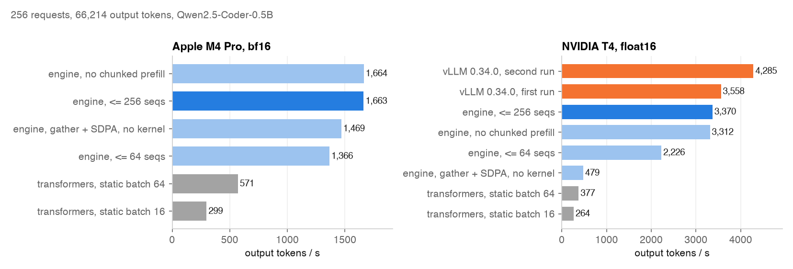
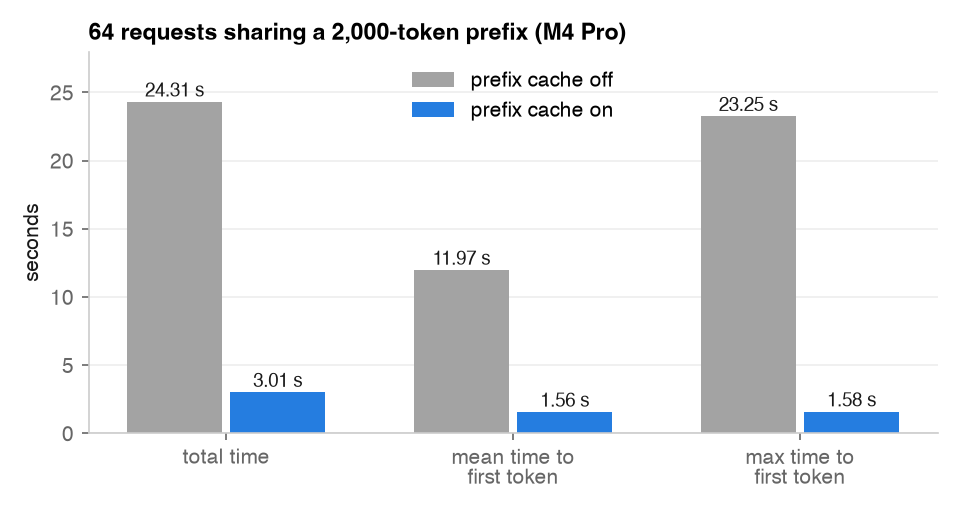
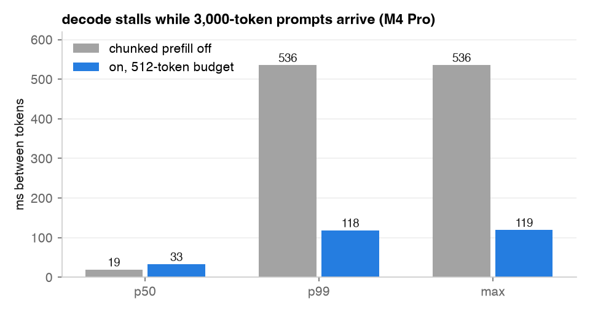
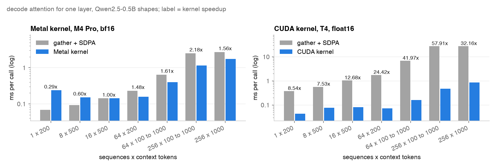

# llm-inference-engine

An LLM serving engine in about 1,800 lines of PyTorch, Metal and CUDA. It loads Llama and Qwen2 checkpoints from Hugging Face and serves them over an OpenAI-compatible HTTP API, with the techniques that production servers such as vLLM are built on:

- **Paged KV cache.** Fixed-size blocks and per-sequence block tables, so memory is used only for tokens that exist.
- **Prefix caching.** Requests that share a prompt prefix reuse its KV blocks instead of recomputing them.
- **Continuous batching.** The batch is rescheduled every step, so requests join and leave mid-flight. Long prompts are split across steps (chunked prefill), and requests are preempted when memory runs out.
- **Speculative decoding.** A small draft model proposes tokens and the target checks them in one pass. Rejection sampling keeps the output distribution exactly the target's.
- **Paged-attention kernels in Metal and CUDA.** They read keys and values straight from the cache blocks, on Apple and NVIDIA GPUs.

The model code is written against the checkpoint tensors (no `transformers` at run time). Its greedy output matches `transformers` token for token on a real checkpoint, with every request batched and the custom kernel on: in float32 on Apple and NVIDIA GPUs, and in float16 on an NVIDIA T4.

On an Apple M4 Pro with Qwen2.5-Coder-0.5B-Instruct:
- **Throughput.** 256 concurrent requests run at 1,663 output tokens/s, 2.9x `transformers.generate` with static batches of 64.
- **Prefix caching.** A burst of 64 requests sharing a 2,000-token prompt finishes in 3.0 s instead of 24.3 s.
- **Metal kernel.** Decode attention is up to 2.2x faster than gather + SDPA.

On an NVIDIA T4 (Kaggle), same model, float16:
- **Throughput.** 3,370 output tokens/s on the same workload: 8.9x `transformers.generate`, and 79% of vLLM 0.34 (4,285 tokens/s once warm).
- **CUDA kernel.** At 256 sequences of 1,000 tokens it is 6.3x faster than PyTorch's fused memory-efficient attention, and 32x faster than the unfused path that SDPA falls back to on this GPU for grouped-query attention.

## Results

Unless a heading says otherwise, the numbers are from an Apple M4 Pro (12-core CPU, 16-core GPU, 24 GB) with PyTorch 2.15, bf16, measured on an otherwise idle machine. The T4 numbers are in their own section below. Raw numbers are in `results/`, and each table comes from the script named in its heading.

### Throughput (`bench/throughput.py`)

256 requests are submitted at once to Qwen2.5-Coder-0.5B-Instruct, with prompts of 32 to 512 tokens and outputs of 16 to 512. EOS is ignored, so every system produces exactly the same 66,214 tokens.

| system | seconds | output tok/s |
|---|---|---|
| engine: continuous batching, <= 256 seqs | 39.8 | 1,663 |
| engine: same, gather + SDPA attention instead of the Metal kernel | 45.1 | 1,469 |
| engine: same, no chunked prefill | 39.8 | 1,664 |
| engine: <= 64 seqs | 48.5 | 1,366 |
| `transformers` generate, static batches of 64 | 115.9 | 571 |
| `transformers` generate, static batches of 16 | 221.6 | 299 |

- **Static batches waste work.** Each batch is padded to its longest prompt and runs until its longest output finishes, so a request that wants 16 tokens holds its slot for up to 512 steps.
- **Continuous batching avoids that.** A finished request leaves immediately and the next one takes its place. The paged cache fits all 256 in a 4 GB KV cache with no preemptions.
- **Kernel and chunking.** The Metal kernel adds 13% end to end. Chunked prefill costs nothing here; what it buys is latency (below).



*Output tokens per second on the same 256-request workload, from `results/throughput.json`, `results/throughput_teslat4.json` and `results/vllm_throughput_teslat4.json`.*

### Prefix caching (`bench/prefix.py`)

64 requests share a 2,000-token prefix, each adding its own 10 to 40 token question, and all arrive at once. Each generates 32 tokens.

| prefix cache | seconds | tokens run through the model | prompt tokens from cache | mean time to first token | max |
|---|---|---|---|---|---|
| off | 24.31 | 131,525 | 0 | 11.97 s | 23.25 s |
| on | 3.01 | 9,429 | 122,064 | 1.56 s | 1.58 s |

The first request computes the prefix; the other 63 attach its blocks. Outputs are identical with and without the cache in float32 (16 of 16). In bf16, 42 of 64 are identical, because the cached keys were computed in a different batch shape and so rounded differently.



*Total time and time to first token with the prefix cache off and on, from `results/prefix.json`.*

### Chunked prefill and latency (`bench/latency.py`)

32 requests are decoding when eight 3,000-token prompts arrive, one every 20 steps. The table gives the time between consecutive tokens of the 32 decoding requests:

| chunked prefill | p50 | p99 | max | long prompts' time to first token |
|---|---|---|---|---|
| off | 19.4 ms | 535.5 ms | 535.9 ms | 0.53 s |
| on, 512-token budget per step | 33.1 ms | 118.5 ms | 119.3 ms | 0.71 s |

- **Without chunking**, each long prompt runs in one 0.5 s step, and every user who is mid-answer sees their output freeze.
- **With chunking**, the prompt is spread over six steps. The worst pause drops 4.5x, at the price of slower typical steps and a slightly later first token for the long prompts.



*Gaps between tokens of the 32 decoding requests, from `results/latency.json`.*

### Speculative decoding (`bench/spec.py`)

Target Qwen2.5-Coder-1.5B-Instruct, draft Qwen2.5-Coder-0.5B-Instruct, 12 coding prompts, 200 tokens each.

| draft tokens k | batch | temperature | tok/s | acceptance | tokens per target pass |
|---|---|---|---|---|---|
| none (target alone) | 1 | 0 | 55.2 | | 1 |
| none (0.5B draft alone) | 1 | 0 | 110.8 | | 1 |
| 2 | 1 | 0 | 69.0 | 0.91 | 2.83 |
| 3 | 1 | 0 | 72.4 | 0.87 | 3.61 |
| 4 | 1 | 0 | 73.5 | 0.84 | 4.35 |
| 6 | 1 | 0 | 72.8 | 0.79 | 5.74 |
| 8 | 1 | 0 | 69.2 | 0.74 | 6.90 |
| none | 12 | 0 | 329.4 | | 1 |
| 4 | 12 | 0 | 343.3 | 0.85 | 4.38 |
| none | 1 | 0.7 | 54.4 | | 1 |
| 4 | 1 | 0.7 | 70.2 | 0.84 | 4.37 |

**Batch 1.** The best setting is k = 4: 1.33x. The draft is right 84% of the time, so each target pass emits 4.35 tokens. Still, the 0.5B draft is only twice as fast per step as the 1.5B target: at batch 1 both are dominated by per-step overhead (hundreds of small kernel launches), not by reading weights. Four draft steps therefore cost about two target steps, which caps the gain.

**Batch 12.** The target pass is no longer memory bound, so checking 5 tokens costs nearly 5 times as much, and the gain drops to 4%.

A larger target, or a draft much cheaper than the target, would favour speculation more. That was not measured here: a 7B target in bf16 does not fit next to everything else in 24 GB.

**Same text as the target.** In float32, greedy output with k = 4 equals the target alone on 6 of 6 prompts. In bf16, 9 of 12 are identical, because a pass over k+1 tokens rounds differently from one-token steps. Batching alone does the same: the target at batch 12 matches its own batch-1 output on 8 of 12.

### Decode attention kernel (`bench/attention.py`)

Attention alone for one layer, with Qwen2.5-0.5B shapes (14 query heads, 2 kv heads, head dim 64), bf16, and random block tables:

| batch | context | KV read | gather + SDPA | Metal kernel | speedup |
|---|---|---|---|---|---|
| 1 | 200 | 0.1 MB | 0.068 ms | 0.238 ms | 0.29x |
| 8 | 500 | 2.0 MB | 0.092 ms | 0.152 ms | 0.60x |
| 16 | 500 | 3.9 MB | 0.142 ms | 0.142 ms | 1.00x |
| 64 | 200 | 6.2 MB | 0.231 ms | 0.157 ms | 1.48x |
| 64 | 100 to 1,000 | 18.3 MB | 0.646 ms | 0.401 ms | 1.61x |
| 256 | 100 to 1,000 | 69.5 MB | 2.512 ms | 1.153 ms | 2.18x |
| 256 | 1,000 | 125.0 MB | 2.727 ms | 1.749 ms | 1.56x |

**Where it wins.** The kernel skips the gather copy and the padding, which matters most for large batches with uneven lengths.

**Where it loses.** With few sequences it launches too few threadgroups, so the runner uses it only for decode batches of 32 or more. It peaks at about 70 GB/s, far below the chip's memory bandwidth, so there is room left: splitting long contexts across threadgroups would be the next step.

**Two other MPS fixes from profiling** (details in the docs):
- `index_select` gathers 10x faster than advanced indexing.
- Splitting the 152k-row vocabulary projection into 8 slices makes it 2.2x faster at batch 64.

### On an NVIDIA T4 (`results/*_teslat4.json`)

One T4 (Turing, sm_75, 16 GB, 320 GB/s) in a Kaggle job: driver 580, CUDA 13.0, PyTorch 2.11. The engine runs in float16, since Turing has no bfloat16 arithmetic.

**Throughput** (`bench/throughput.py`, `bench/vllm_throughput.py`): the same workload as above, 66,214 output tokens.

| system | seconds | output tok/s |
|---|---|---|
| engine: continuous batching, <= 256 seqs | 19.6 | 3,370 |
| engine: same, gather + SDPA attention instead of the CUDA kernel | 138.3 | 479 |
| engine: same, no chunked prefill | 20.0 | 3,312 |
| engine: <= 64 seqs | 29.8 | 2,226 |
| `transformers` generate, static batches of 64 | 175.4 | 377 |
| `transformers` generate, static batches of 16 | 250.4 | 264 |
| vLLM 0.34.0, first run | 18.6 | 3,558 |
| vLLM 0.34.0, second run | 15.5 | 4,285 |

- **Against vLLM.** vLLM gets the same prompts and output lengths, float16, at most 256 sequences and 4,096 tokens per step. Its first run includes Triton compiling an attention kernel for shapes the warm-up missed, so the second run is the fair one: the engine reaches 79% of it. vLLM also captures CUDA graphs and compiles the model; the engine runs one eager Python step per token.
- **The kernel matters more here than on the Mac.** Without it, throughput drops 7x. That row is unfair to SDPA, though (see below): on this GPU SDPA falls back to its unfused path for this call.

**Decode attention** (`bench/attention.py`), the same shapes as the Metal table, float16:

| batch | context | KV read | gather + SDPA | CUDA kernel | speedup | kernel GB/s |
|---|---|---|---|---|---|---|
| 1 | 200 | 0.1 MB | 0.378 ms | 0.044 ms | 8.5x | 2.2 |
| 8 | 500 | 2.0 MB | 0.569 ms | 0.076 ms | 7.5x | 25 |
| 16 | 500 | 3.9 MB | 1.042 ms | 0.082 ms | 12.7x | 46 |
| 64 | 200 | 6.2 MB | 1.753 ms | 0.072 ms | 24.4x | 85 |
| 64 | 100 to 1,000 | 18.3 MB | 6.792 ms | 0.162 ms | 42.0x | 111 |
| 256 | 100 to 1,000 | 69.5 MB | 27.346 ms | 0.472 ms | 57.9x | 144 |
| 256 | 1,000 | 125.0 MB | 27.512 ms | 0.856 ms | 32.2x | 143 |

**Why the baseline is so slow** (`bench/sdpa_backends.py`, `results/sdpa_backends_teslat4.txt`; batch 256, 1,000 keys of which the last 100 are masked):
- With `enable_gqa=True` and a padding mask, no fused SDPA kernel accepts the call on a T4. Flash attention needs sm_80 or newer, and the memory-efficient kernel needs as many key heads as query heads. PyTorch falls back to its math path: 27.6 ms.
- With K and V first repeated to 14 heads, the memory-efficient kernel runs: 5.35 ms, not counting the repeat.
- The CUDA kernel takes 0.86 ms, so 6.3x is the fair comparison. It reads 143 GB/s, 45% of the T4's bandwidth.

Unlike the Metal kernel, it is faster than the baseline even for one sequence, so on CUDA the runner uses it for every decode batch.



*Time per decode attention call, log scale, from `results/attention.json` and `results/attention_teslat4.json`. On the T4 the baseline is SDPA's unfused fallback, so the fair speedup there is 6.3x (see above).*

## Correctness

The tests run on CPU in CI against random checkpoints made by `transformers`, so they need no download. 29 tests run in about 10 s there; 5 more need an Apple GPU and 9 more an NVIDIA GPU. On the M4 Pro 34 pass, on the T4 38:

- **Model** (`test_model.py`). Logits equal `transformers`' exactly (max difference 0.0 in float32) for Llama and Qwen2. This holds for prefill, uneven chunked prefill, decode, and mixed batches on shuffled physical blocks.
- **Engine** (`test_engine.py`). Greedy output equals a no-cache reference while the scheduler chunks prompts and admits sequences mid-flight. Output is unchanged:
  - by preemption, with the KV cache sized so sequences get evicted;
  - by prefix caching, and the hit count is checked too;
  - by batching: a seeded sampled request gives the same tokens alone and in a busy batch.
- **Block manager** (`test_block_manager.py`). 5,000 random allocate, grow, trim and free operations on shared prefixes, checking reference counts, free lists and the cache index after each one.
- **Speculative decoding** (`test_spec.py`).
  - Greedy output equals the target's for k = 1, 3 and 5, including under preemption.
  - With a vocabulary of 4, 12,000 sampled three-token continuations match the target's exact joint distribution: chi-square 45.9 on 63 degrees of freedom, against a 99.9% limit of 103.4.
  - A version with a wrong residual distribution fails at 3,383, so the test can tell.
- **Metal kernel** (`test_metal.py`, Apple GPUs only). It agrees with the reference to 1e-5 for head dims 64 and 128 and grouped-query ratios 1 to 8. The engine gives identical output with it on or off.
- **CUDA kernel** (`test_cuda.py`, NVIDIA GPUs only). It agrees with the reference to 1e-5 in float32 and 2e-3 in float16, for head dims 64 and 128 and grouped-query ratios 1 to 8, over contexts from 1 to 777 tokens on shuffled blocks. The engine gives identical output with it on or off.
- **Server** (`test_server.py`). Concurrent HTTP requests give the same text as offline generation, and streamed deltas add up to the non-streamed text.

On the real Qwen2.5-Coder-0.5B-Instruct, the engine and `transformers.generate` were compared with 12 prompts and 128 greedy tokens each (`bench/check_hf.py`):
- **float32:** 12 of 12 outputs identical.
- **bf16:** 8 of 12 identical. The other four diverge after 12 to 66 tokens, since bf16 rounding differs between batch shapes.
- **On the T4, with the CUDA kernel:** 12 of 12 identical in float32, and 12 of 12 in float16.

One trap here: Qwen's `generation_config.json` sets `repetition_penalty: 1.05`, which `generate()` applies even with `do_sample=False`. Before turning it off, every comparison diverged within a few tokens.

## Run it

```bash
pip install -r requirements.txt        # torch, safetensors, tokenizers, jinja2, huggingface_hub
python -m infer.server --model Qwen/Qwen2.5-Coder-0.5B-Instruct --port 8000
# with a draft model
python -m infer.server --model Qwen/Qwen2.5-Coder-1.5B-Instruct --draft Qwen/Qwen2.5-Coder-0.5B-Instruct
```

```bash
curl localhost:8000/v1/chat/completions -d '{
  "messages": [{"role": "user", "content": "Reverse a string in Python."}],
  "temperature": 0, "max_tokens": 100, "stream": true}'
curl localhost:8000/metrics      # running, waiting, kv usage, prefix cache hits, acceptance rate
```

From Python:

```python
from infer.engine import Engine
from infer.sequence import SamplingParams
eng = Engine("path/to/checkpoint")          # cuda, mps or cpu, picked automatically
out = eng.generate([[9707, 11, 1879]], SamplingParams(max_tokens=32, temperature=0.7, seed=0))
```

Tests and benchmarks:

```bash
pip install -r requirements-dev.txt
python -m pytest -q
python bench/throughput.py    # also: attention, prefix, latency, spec, check_hf, sdpa_backends
python bench/vllm_throughput.py --model <path>   # in its own env: pip install vllm
```

## Layout

```
infer/
  model.py          llama / qwen2 forward over a flat batch, paged kv writes and reads
  runner.py         scheduled sequences -> token, position, slot and mask tensors
  block_manager.py  block allocation, reference counts, prefix cache, lru eviction
  scheduler.py      continuous batching, chunked prefill, preemption
  engine.py         the step loop, sampling, speculative decoding
  sampler.py        temperature, top-k, top-p, per-request inverse-cdf draws
  metal.py          paged decode attention kernel for apple gpus
  cuda_attn.py      the same for nvidia gpus, compiled on first use
  server.py         openai-style http api with server-sent events
  tokenizer.py      tokenizer.json, chat templates, streaming detokenizer
tests/              pytest, cpu, random checkpoints
bench/              the scripts behind every number above
docs/how-it-works.md
```

`docs/how-it-works.md` explains each part: the paging, the prefix hash chain, the scheduler, the proof that speculative sampling is exact, how the Metal kernel design went from slower than the baseline to 2.5x faster, and the CUDA port.

## Limits

- **Tested on an Apple M4 Pro, an NVIDIA T4 and CPU.** On Ampere and newer GPUs the engine defaults to bf16, which the CUDA kernel does not handle, so it would fall back to gather + SDPA (where flash attention is available). That path has not been run there.
- **Model support.** Llama, Qwen2 and Mistral-style checkpoints without sliding-window attention or RoPE scaling. No quantization, no tensor parallelism.
- **Requests.** One completion per request: no beam search, no `n > 1` and no stop strings, though stop token ids work.
- **Python overhead.** The engine runs one Python step per token, with no CUDA graphs or compiled step. That overhead matters most at batch 1.
